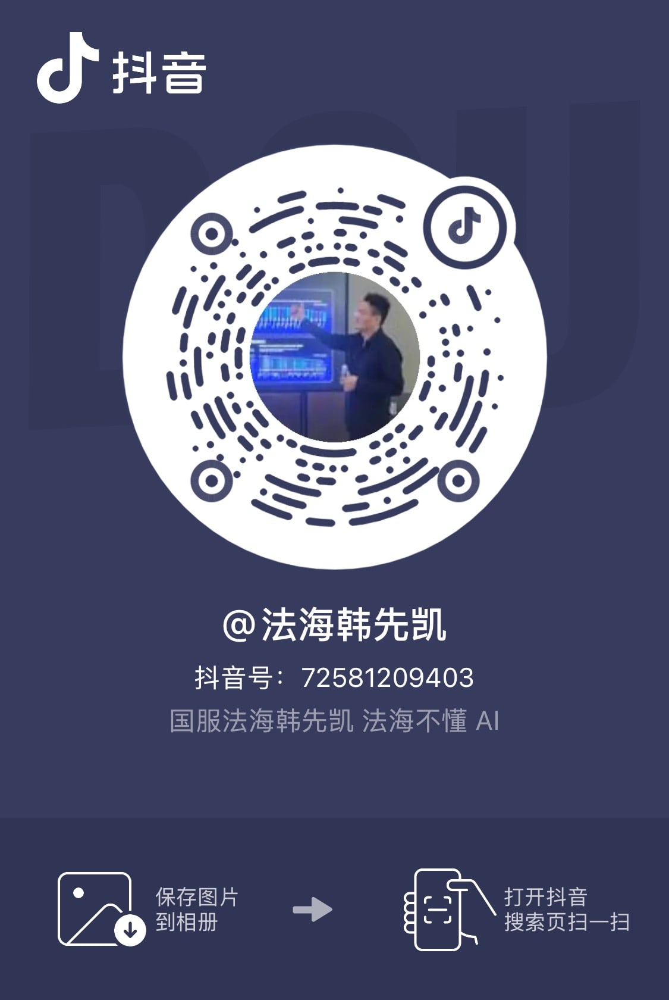

# Life Level-up Guide

[中文](https://byoungd.github.io/up/) | English

**By Han Xiankai, pen name “Li Pu”**

**A lifelong-learning guide for the AI era.** This living open manuscript begins with English and continues into AI learning, real projects, business experiments, recovery, and the work of returning your life to yourself one small act at a time.

This is not a book that turns life into a polished plan. Think of it as a workshop you can return to: bring a real problem, find your starting point, complete one small action, preserve evidence you can review, and choose what comes next. AI can help you find answers. Judgment, boundaries, and responsibility remain yours.

You do not have to prove that you are clever or disciplined enough to deserve help, and you do not have to finish the book in one sitting. Read a few pages, do one thing, and let the result change your route. There is no shortcut that guarantees success here, only a record tested through action, failure, recovery, and beginning again.

**What you get:** a bilingual open manuscript, downloadable EPUB/PDF editions, reusable worksheets, and a practice path that starts in five minutes, retests one change after fourteen days, and reviews the system after ninety days.

  Living manuscript
  <a href="./book-downloads">Download Center</a>
  <a href="../downloads/life-level-up-guide-en.epub" download>Download English EPUB</a>
  <a href="../downloads/life-level-up-guide-zh.epub" download>下载中文 EPUB</a>
  <a href="../downloads/life-level-up-guide-en.pdf" download>Download English PDF</a>
  <a href="../downloads/life-level-up-guide-zh.pdf" download>下载中文 PDF</a>
  <a href="https://github.com/byoungd/up">Source and corrections</a>
  <a href="./templates/reader-field-note">Reader Field Note</a>
  <a href="https://github.com/byoungd/up/blob/main/CITATION.cff">Citation</a>
  <a href="https://creativecommons.org/licenses/by-nc/4.0/">Text CC BY-NC 4.0</a>

  

    START HERE
    <h2 id="quick-start-title">Choose one action before choosing how much to read</h2>
    
You do not need to read the whole book on your first visit. Choose one entry for today, complete a small action, and let the result point to the next page.

  

  

    <a class="quick-start-action" href="./threads/part-0/reader-guide"><strong>5 minutes: I do not know where to begin</strong>Choose a route by problem, see what evidence to keep, and learn how to return after an interruption.</a>
    <a class="quick-start-action" href="./templates/learning-state"><strong>Today: I want to finish one thing</strong>Write the real problem, current evidence, smallest action, and boundary, then make an output someone can see.</a>
    <a class="quick-start-action" href="./threads/part-1/open-input"><strong>14 days: I want to practice one English skill</strong>Choose listening, speaking, reading, or writing; keep a first sample and retest under new conditions.</a>
  

  
Ready for a full cycle? Start with the <a href="./templates/90-day-cycle">90-Day Cycle Map</a> and carry one experiment into real work and life.

If this guide helps you complete one real action, please [star the repository](https://github.com/byoungd/up) so more learners can find it. For an error, translation gap, or reproducible practice result, use the [issue templates](https://github.com/byoungd/up/issues/new/choose).

## Choose Your Entry Point

This guide is for people who want to improve their English, learn with AI, finish real work, or rebuild a workable rhythm of life. Start with the problem in front of you. You do not need to read from page one or open every subject at once.

| Your current situation | Start here | One result to preserve |
| --- | --- | --- |
| You do not know which page to open | [Reader's Guide](threads/part-0/reader-guide.md) | A problem-based reading route |
| You want a real baseline for English skills | [English Diagnostic](templates/english-diagnostic.md) | A first sample on one topic and one barrier |
| You want AI in your work without outsourcing judgment | [AI Learning](threads/part-3/1-ai-learning.md) · [AI Evaluation](templates/ai-evaluation.md) | A reviewable experiment and acceptance criteria |
| You want to finish a project or test a business idea | [From Problems to First Customers](threads/practice/customer-discovery.md) · [Startup Experiment](templates/startup-experiment.md) | A real output, user feedback, or a failure record |
| You are rebuilding a daily rhythm | [Life Practice Toolkit](templates/life-practice-toolkit.md) | A boundary you can care for today and the smallest next task |
| You need an offline copy or a citation | <a href="./book-downloads">Download Center</a> · [Citation](https://github.com/byoungd/up/blob/main/CITATION.cff) | An EPUB/PDF file or a standard citation |

Every subject follows one working line: **define the problem → preserve a baseline → complete the smallest task → record evidence → retest later → decide what transfers.** AI can help break work down, ask questions, compare options, and give feedback. People still confirm the goal, sources, privacy, acceptance, and final responsibility.

AI makes answers cheaper by the day. In seconds, we can get an explanation, code, a plan, even confident-sounding advice about life. What remains scarce is knowing which questions deserve pursuit, which evidence deserves trust, how to turn suggestions into real work, and how to take responsibility for the final judgment.

The project began in 2017 as Li Pu's English Learning Guide. English was once the whole map; now it is one foundational road within it. The manuscript has widened into AI learning, project development, resource-layer business, life review, and recovery. The question underneath it is still the same: **when the world keeps changing, can I continue to learn, create, and participate in my own life?**

My name is Han Xiankai, also known online as Li Pu, and I serve as chairman of China Token Cloud Computing Co., Ltd. I test these methods in learning, software development, enterprise services, and ordinary life. My role and commercial relationships belong in public view. Claims about ability, products, and revenue must be earned by work, users, costs, and time.

The guide returns to one loop:

**find a problem → learn actively → work with AI → complete a real task → preserve evidence → review and transfer**

It keeps three kinds of claim separate:

- **Research findings** include sources and state the reach of the evidence.
- **Personal experience** keeps its warmth without pretending to be a universal prescription.
- **Hypotheses** may enter the conversation, but the next experiment must test them.

  <section class="guide-path-group" aria-labelledby="guide-foundation">
01<h2 id="guide-foundation">Build the Foundation</h2>
Put the problem, language, and daily action on one map.

    <a class="guide-path" href="./templates/learning-state"><strong>Lifelong Learning System</strong>Begin with a real problem, a current baseline, and a minimum task so each cycle can continue, be retested, and transfer.</a>
    <a class="guide-path" href="./threads/part-1/0-cefr"><strong>Foundation: English</strong>Use English to reach global knowledge, technical documentation, and international AI tools, entering cross-cultural work through intelligibility rather than accent similarity.</a>
    <a class="guide-path" href="./threads/part-1/grammar"><strong>Grammar for Real Expression</strong>Start with whether time, responsibility, condition, and certainty are understood; retest one high-impact structure for fourteen days instead of memorising every rule first.</a>
    <a class="guide-path" href="./threads/part-1/6-writing"><strong>Writing and Asynchronous Delivery</strong>Preserve an unaided draft, fact sources, and revision reasons so email, reports, decisions, and handovers remain useful when the author is offline.</a>
  
</section>
  <section class="guide-path-group" aria-labelledby="guide-amplify">
02<h2 id="guide-amplify">Amplify Ability with Tools</h2>
Let AI accelerate questions and verification while people keep judgment, testing, and responsibility.

    <a class="guide-path" href="./threads/part-3/1-ai-learning"><strong>Learn Anything with AI</strong>Use AI for questions, research, and feedback while keeping fact-checking and final judgment in human hands.</a>
    <a class="guide-path" href="./threads/part-3/2-ai-development-and-resource-layer"><strong>AI Projects and Resource-layer Business</strong>Move from requirements, prototypes, code, and tests to model access, governance, enterprise delivery, and business validation.</a>
  
</section>
  <section class="guide-path-group" aria-labelledby="guide-life">
03<h2 id="guide-life">Enter Real Life</h2>
Carry learning into work, family, relationships, and the author's responsibilities.

    <a class="guide-path" href="./threads/part-1/8-job-search-english"><strong>Global Job Search and Remote Work</strong>Turn a job description into recruiter communication, project explanation, unfamiliar follow-ups, and asynchronous writing, then use real samples to locate the next gap.</a>
    <a class="guide-path" href="./threads/part-4/family-learning"><strong>Family and Middle-School Learning</strong>Let the learner help define the goal while adults protect environment, privacy, and safety; use fourteen days of evidence instead of surveillance or substituted work.</a>
    <a class="guide-path" href="./threads/part-2/communication"><strong>Communication: Let Each Other Be Heard</strong>Start with observation, feeling, need, and request, then keep respect and choice alive through expression, listening, refusal, and repair.</a>
    <a class="guide-path" href="./threads/part-2/care-and-carry-on"><strong>Care for the People Nearby</strong>Turn care into listening, practical help, and shared tasks. Accept support when both people are willing and able, keeping warmth and boundaries together.</a>
    <a class="guide-path" href="./threads/part-2/my-story"><strong>Life Review and Recovery</strong>Acknowledge failure and cost, then rebuild judgment, order, and action after disruption.</a>
    <a class="guide-path" href="./projects"><strong>Author Projects and Practice</strong>Make affiliations, purpose, update dates, and non-sponsorship visible so trust does not depend on guesswork.</a>
  
</section>
  <section class="guide-path-group guide-path-group-external" aria-labelledby="guide-external">
04<h2 id="guide-external">Third-party Resources</h2>
Optional external entry points, not safety, quality, or compliance endorsements by this book or its author.

    <a class="guide-path" href="https://biezou.com/" target="_blank" rel="noopener noreferrer"><strong>AI Relay Recommendation: biezou.com</strong>This is an optional third-party entry point. The official site describes a unified AI API gateway and admin dashboard. Verify terms, pricing, privacy, and availability before use.</a>
    <a class="guide-path" href="https://t.me/OpenHuge_ai" target="_blank" rel="noopener noreferrer"><strong>AI Resources on Telegram: OpenHuge_ai</strong>This is a third-party Telegram channel for discovering AI resources. Posts, outbound links, and availability can change; verify sources, privacy, copyright, and security risks.</a>
  
</section>

## Business, Discipline, and AI in Practice

Use the [Practice Map](practice.md) to choose a current problem and turn reading into a small experiment with inspectable results. These handbooks complement the six-part book and are included in its digital appendices.

| Current task | Practical handbook | Copyable tool |
| --- | --- | --- |
| A business idea without customer evidence | [From Problems to First Customers](threads/practice/customer-discovery.md) · [A Sustainable Small Business](threads/practice/sustainable-business.md) | [Startup Experiment](templates/startup-experiment.md) |
| Trouble starting or returning after a break | [Discipline and Consistency](threads/practice/discipline-and-consistency.md) | [Consistency Plan](templates/consistency-plan.md) |
| AI generates output but delivery is unreliable | [AI Workflows](threads/practice/ai-workflows.md) · [AI Evaluation and Reliability](threads/practice/ai-evaluation.md) | [AI Evaluation Record](templates/ai-evaluation.md) |

## Book Structure

For a complete read, begin with the [Reader's Guide: Put the Book Back into Life](threads/part-0/reader-guide.md), then continue to the [Prologue: Do Not Rush to Change Your Life](threads/part-0/prologue.md). The guide helps you choose an entry, preserve evidence, and return after interruption; the prologue places these methods in one person's story. The book is a loop we revisit, not a straight climb.

Use the [Glossary of Terms and Methods](reference/glossary.md) to follow “definition → evidence → next step” back to the main path. If you are unsure which worksheet fits, start with the [Toolkit Overview](templates/toolkit.md).

| Part | Core question | Entry point |
| --- | --- | --- |
| Reader's Guide and Prologue | Where do I enter, and why begin again? | [Reader's Guide](threads/part-0/reader-guide.md) · [Do Not Rush to Change Your Life](threads/part-0/prologue.md) |
| Part I: Open Input | How do I build a bridge between English and the world, then carry ability into interviews and remote collaboration? | [Part Introduction](threads/part-1/open-input.md) · [CEFR Self-check](threads/part-1/0-cefr.md) · [Vocabulary](threads/part-1/2-vocabulary.md) · [Grammar](threads/part-1/grammar.md) · [Listening](threads/part-1/3-listening.md) · [Reading](threads/part-1/4-reading.md) · [Speaking](threads/part-1/5-speaking.md) · [Writing](threads/part-1/6-writing.md) · [Job-search English](threads/part-1/8-job-search-english.md) |
| Part II: Return to Life | How do ability, work, relationships, failure, choices, and recovery affect one another? | [Part Introduction](threads/part-2/return-to-life.md) · [My Story](threads/part-2/my-story.md) · [Depression, Anxiety, and Recovery](threads/part-2/depression-anxiety-recovery.md) · [Narrative and Evidence](threads/part-2/narrative-and-evidence.md) · [Recovery and Decisions](threads/part-2/recovery.md) · [Communication](threads/part-2/communication.md) · [Relationships](threads/part-2/relationships.md) · [Care and Shared Responsibility](threads/part-2/care-and-carry-on.md) · [Entrepreneurship](threads/part-2/entrepreneurship.md) |
| Part III: Amplify Ability | How can I use AI without outsourcing judgment or attention? | [Part Introduction](threads/part-3/amplify-ability.md) · [AI Learning](threads/part-3/1-ai-learning.md) · [Attention, Artifacts, and Evidence](threads/part-3/3-attention-and-judgment.md) · [Project Practice](threads/part-3/2-ai-development-and-resource-layer.md) |
| Part IV: Practice and Recovery | How does learning return to the body, family, and daily life while protecting a young learner's agency? | [Part Introduction](threads/part-4/practice-and-recovery.md) · [First Week Practice](threads/part-4/week-1.md) · [Family Learning](threads/part-4/family-learning.md) · [Daily System](threads/part-4/daily-system.md) · [Rhythm](threads/part-4/rhythm-and-compounding.md) |
| Part V: Long-Term Action | How can ninety days, a real project, and the period afterward keep a method accountable? | [Part Introduction](threads/part-5/long-term-action.md) · [90-Day Action Plan](threads/part-5/90-day-plan.md) · [Book Case Study](threads/part-5/book-as-proof.md) · [After Ninety Days](threads/part-5/after-90-days.md) |
| Part VI: Be Your Own Lifelong Friend | How can I understand, recognise, care for, and improve myself through change? | [Understanding Yourself](threads/part-6/1-understanding-yourself.md) · [Knowing Yourself](threads/part-6/2-knowing-yourself.md) · [Being Kind to Yourself](threads/part-6/3-being-kind-to-yourself.md) · [Improving Yourself](threads/part-6/4-improving-yourself.md) · [Being Your Own Lifelong Friend](threads/part-6/5-being-your-own-lifelong-friend.md) |
| Afterword | Who do I want to become after leveling up? | [The Greatest Progress Is Finding Your True Self](threads/part-6/afterword.md) |

## Begin with One Small Act Today

Lifelong learning is not opening ten courses at once. It is completing one act today that leaves a trace:

1. Choose a real problem: a blocked step at work, a concept you need to understand, a person you want to help, or a small unfinished project.
2. Record your baseline in [Learning State](templates/learning-state.md): what you know, what you cannot yet do, and what would count as complete. For decisions, attention, relationships, or recovery, use the [Life Practice Toolkit](templates/life-practice-toolkit.md).
3. Ask AI to help shape a 25–45 minute task, then check the sources, make the choices, and finish the output yourself.
4. Preserve notes, code, a recording, an email, or feedback rather than saving only the conversation.
5. A week later, use the [Weekly Review](templates/weekly-review.md) to examine completion, quality, retention, and transfer before choosing the next step.

You do not have to see the whole road. The first piece of evidence you preserve today becomes somewhere the next step can stand.

## AI Learning and Project Practice: From Answers to Delivery

When tools change too quickly to follow, start with [AI Trends and a Learning Roadmap](threads/part-3/6-ai-trends-and-learning-roadmap.md). Use an [AI Trend Experiment](templates/ai-trend-radar.md) to test one new capability: check primary sources, keep a manual baseline, measure full costs, and decide whether to continue.

[Learning Anything with AI](threads/part-3/1-ai-learning.md) begins with “What problem am I trying to solve?” [Attention](threads/part-3/3-attention-and-judgment.md) addresses input boundaries and independent judgment, [Artifacts](threads/part-3/4-artifacts-and-delivery.md) moves understanding toward a deliverable, and [Evidence](threads/part-3/5-evidence-and-transfer.md) checks immediate performance, delayed retention, and transfer. AI can ask, explain, compare, and generate practice; people still set the goal, choose sources, detect fabrication, and use what they learned after the conversation closes.

When learning enters a project, [AI Learning, Project Development, and Resource-layer Entrepreneurship](threads/part-3/2-ai-development-and-resource-layer.md) extends the work into requirements, prototypes, code, tests, documentation, and delivery. Speed is not the only measure. Important decisions should be explainable, testable, or reversible, and convenience must not erase boundaries around customer data, company secrets, or third-party privacy.

Through China Token Cloud and `token.love`, this path also examines model access, routing, metering, permissions, deployment, operations, and enterprise support. It asks why a customer might pay, how work should be accepted, and whether costs can be covered. It does not claim proven profit or promise that everyone can make money with AI.

A software failure in 2022 showed me that missing datasets, old architecture, and preset results can hide behind UI and an “AI” story for a while, but cannot survive real users, costs, and incidents. That is why the method insists on baselines, evidence, rollback, cost, and responsibility. Products change; source verification, data safety, acceptance, and final responsibility cannot be outsourced.

## For Those Still Looking for Direction

### For Younger Readers

You do not have to identify one permanently correct direction in your twenties. Many paths emerge after you complete a few small projects, see several kinds of work, and carry the consequences of a few decisions. Keeping the ability to learn and turn is more reliable than choosing a perfect track.

If career anxiety keeps you collecting courses, certificates, and success stories, trade some of that collection for a project you can finish in two weeks. Solve a nearby problem, make a tool that runs, write a sourced article, or improve part of a real user's process. The project may fail, but it will show you what you enjoy, what you lack, whether you can deliver, and whether another person finds the result useful.

AI can lower the cost of exploration, learning, and creation. It cannot build your reputation. Visible work, code, writing, customer feedback, review notes, and relationships with people who choose to work with you again can compound over time.

### For Anyone in a Difficult Season

Unemployment, business failure, the end of a relationship, damaged health, and prolonged uncertainty can reduce a person's capacity to act. A low point is not an examination you must immediately win. Reduce life to a scale you can care for: sleep, eat, step outside, answer one important email, or tell someone trustworthy, “I need help right now.”

Pausing is not surrender. Asking for help is not weakness. If five minutes is what you can do today, preserve five minutes of evidence and add weight when strength returns. These personal stories are not medical care or psychotherapy. If low mood, sleeplessness, hopelessness, or thoughts of harm persist, contact someone you trust and seek qualified local medical or mental-health support. Safety comes before growth.

## Foundation: English Remains an Important Door

English is no longer the whole guide, but it remains a foundation for lifelong learning. It helps you read global knowledge and technical documentation, follow international courses and research, use more AI tools, and work across cultures with less mediation.

Use [CEFR Goals and Self-check](threads/part-1/0-cefr.md) to establish a baseline, then enter [Learning Principles](threads/part-1/1-understanding.md), [Vocabulary](threads/part-1/2-vocabulary.md), [Grammar](threads/part-1/grammar.md), [Listening](threads/part-1/3-listening.md), [Reading](threads/part-1/4-reading.md), [Speaking](threads/part-1/5-speaking.md), [Writing](threads/part-1/6-writing.md), or [Learning English with AI](threads/part-1/7-ai.md) as the task requires. You can also begin with the [English Diagnostic](templates/english-diagnostic.md), [Vocabulary Evidence Card](templates/vocabulary-audit.md), [Listening Evidence Card](templates/listening-audit.md), [Reading Evidence Card](templates/reading-evidence.md), [Speaking Evidence Card](templates/speaking-evidence.md), or [Writing Evidence Card](templates/writing-evidence.md).

English ability is not proved by a collection of words. It is proved by what you can understand, express, and complete in a real situation. English is a bridge, not a wall against which to measure your worth. When the four skills differ, do not average them into a verdict: preserve a first sample in each, choose one barrier, run a parallel task after seven days, and retest one real delivery after thirty days.

## Life Review and Recovery

The [Communication chapter](threads/part-2/communication.md) brings observation, feeling, need, and request into family, intimate, and work settings, connecting them to boundaries, repair, and leaving.

[My Story](threads/part-2/my-story.md), [Narrative and Evidence](threads/part-2/narrative-and-evidence.md), [Echoes](threads/part-2/x-misc.md), [Recovery](threads/part-2/recovery.md), [Decision-Making](threads/part-2/decision.md), [Relationships](threads/part-2/relationships.md), [Care](threads/part-2/care-and-carry-on.md), [Entrepreneurship](threads/part-2/entrepreneurship.md), and the [Archive](threads/archive/README.md) preserve failure, disrupted health, changing relationships, departure, and return. Looking back separates fact, harm, responsibility, and luck so we can ask which decisions worked, which costs must not be hidden, and how to live more honestly next time.

Personal experience is not medical, legal, investment, or business advice. Public content follows data minimisation and does not expose unnecessary third-party identity. Stories and photographs involving others are retained only with clear permission and respect for privacy.

## Life Is Still Moving

A method reveals its strength only after it enters a life. Relationships end and may begin again. Work changes. Learning acquires new meaning when it returns to real people and real problems.

  <figure class="latest-update">
    
    <figcaption><strong>Trusting encounter again</strong>After the end of a relationship, recovery, and the work of reorganising life, Han Xiankai has begun a new relationship. Beginning again does not erase the past, but it shows that life can keep growing.</figcaption>
  </figure>
  <figure class="latest-update">
    
    <figcaption><strong>Visiting Alibaba</strong>I visited Alibaba to learn about Qwen at its on-site display.</figcaption>
  </figure>

## Author Projects and Disclosure

Products, company visits, and real-world projects involving Han Xiankai live on [Author Projects and Practice](projects.md). That page states the relationship, purpose, update date, and non-sponsorship status. Commercial relationships do not change the guide's recommendation standard; by default, the site uses no ads, analytics, or trackers.

You can also follow me on [X](https://x.com/ourleap) for updates on AI practice, English learning, and personal growth.

### Continue on Douyin

Follow **Han Xiankai of China Token Cloud (Douyin ID: 72581209403)** for short updates on English practice, AI collaboration, real projects, and life-level-up work. The QR code is only a public account-following entry point; the site has no ads, analytics, or trackers and does not collect visit data through a follow. If scanning is unavailable, search Douyin for “Han Xiankai” or `72581209403`.

<figure class="author-social-card">
  
  <figcaption>Author-provided public account QR code; image metadata has been removed.</figcaption>
</figure>

## Project Boundaries

- This is an open-content project, not open-source software in the OSI sense. Text and author-created content use **CC BY-NC 4.0**; site configuration, checks, and build code use **MIT**. See [Licensing](https://github.com/byoungd/up/blob/main/LICENSE.md).
- Sources and licensing status for quotations, images, and third-party material are recorded in [Attributions](https://github.com/byoungd/up/blob/main/ATTRIBUTIONS.md).
- Read [Contributing](https://github.com/byoungd/up/blob/main/CONTRIBUTING.md), the [中文贡献指南](https://github.com/byoungd/up/blob/main/CONTRIBUTING.zh-CN.md), and the [Code of Conduct](https://github.com/byoungd/up/blob/main/CODE_OF_CONDUCT.md) before contributing.
- Check dates for product and service entries are recorded per page and in [Attributions](https://github.com/byoungd/up/blob/main/ATTRIBUTIONS.md); capability, availability, and compliance scope still require official pages, formal terms, and real acceptance. Outdated notes are welcome as issues.

## Read Online

- [GitHub Pages](https://byoungd.github.io/up/en/)
- [GitHub repository](https://github.com/byoungd/up)
- Historical writing has been preserved in [Entrepreneurship](threads/part-2/entrepreneurship.md) and [My Story](threads/part-2/my-story.md); unstable external archive links are not used as current entry points.

If you do one thing today, create a [Learning State](templates/learning-state.md), write down the real problem, current evidence, and smallest next task, then complete it. You do not have to see the whole road before you begin; some roads appear only after your foot lands.
